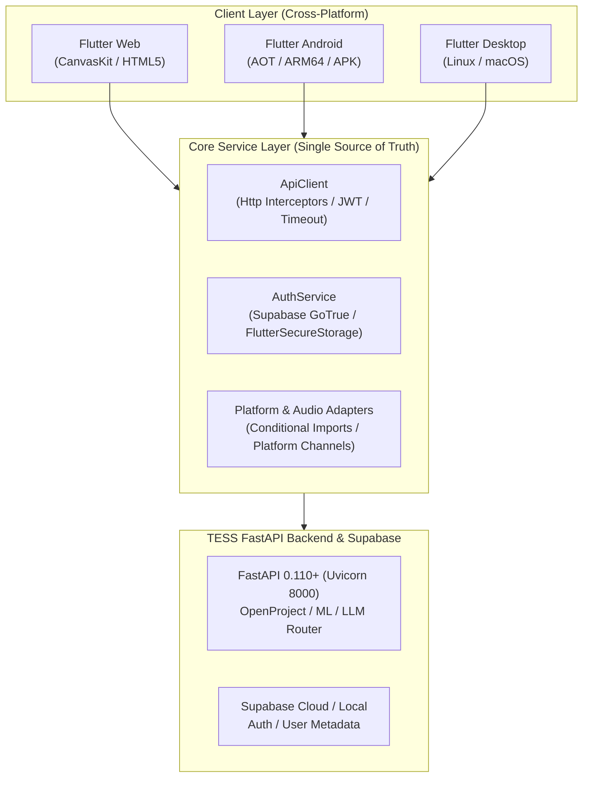
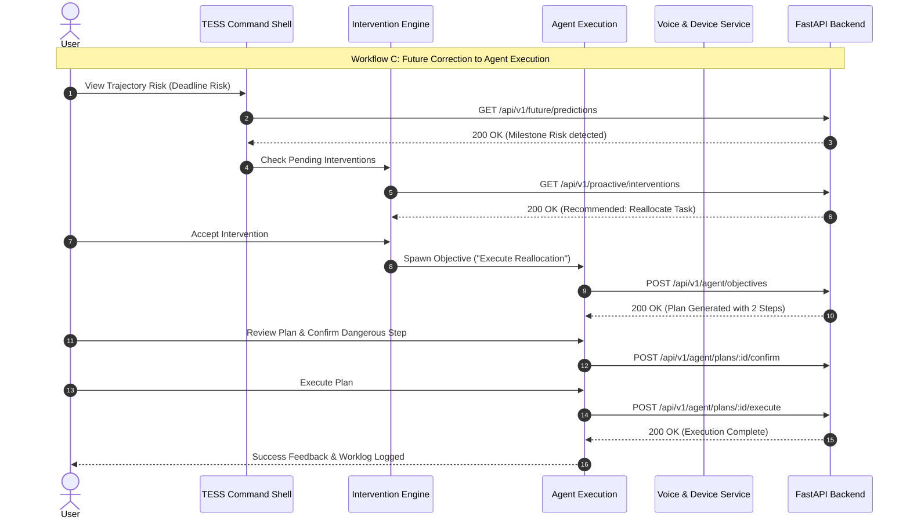

# TESS Phase 14.10 — Learning Guide: Final Integration, Android Architecture & Release Readiness

## 1. Executive Summary

Phase 14.10 represents the capstone integration and release-readiness stabilization for the TESS Flutter application (`flutter_app/`). Spanning Phases 14.1 through 14.9, TESS evolved from an initial scaffold into an autonomous executive assistant combining:
- Supabase JWT authentication and secure session persistence.
- Live OpenProject task orchestration and productivity telemetry.
- Conversational chat with personal episodic and semantic memory continuity.
- Future trajectory simulation and multi-horizon risk forecasting.
- Proactive interventions and nudge scheduling.
- Reversible autonomous agent execution with confirmation gates.
- Speech-to-text, text-to-speech, and consented multimodal screen understanding.

This guide provides deep technical documentation on how these subsystems coalesce into a single coherent, production-ready mobile architecture.

---

## 2. Multi-Target Architecture & Build Philosophy

### 2.1 The Single Source of Truth
Rather than maintaining platform-divergent codebases, `flutter_app/` leverages Flutter's high-level abstractions:
- **Presentation Layer**: Widget trees composed of responsive layouts (`LayoutBuilder`, `SingleChildScrollView`, glassmorphic cards).
- **Controller/Provider Layer**: `ValueNotifier` and `ChangeNotifier` state machines that decouple business logic from rendering frames.
- **Service Layer**: Pure Dart services consuming `ApiClient` and `AuthService`, agnostic of platform runtime.
- **Platform Abstraction Layer**: Services requiring hardware access (e.g. `AudioRecorder`, `AudioPlayer`, `DeviceNotificationService`) degrade gracefully when run under environments where specific native drivers are mocked or unavailable.

---

## 3. End-to-End Workflow Synthesis

Phase 14.10 validates 7 cross-functional workflows that bind independent modules into a continuous user journey:

### 3.1 Workflow Invariants
1. **Zero Unauthenticated Traffic**: Every endpoint (except public `/health`) demands a valid Supabase JWT Bearer token in the `Authorization` header.
2. **Reversible Destructive Operations**: Any agent step flagged with `requires_confirmation = true` halts automated execution until an explicit cryptographic/HTTP confirmation token is dispatched.
3. **Optimistic UI with Synchronous Rollback**: UI state updates immediately upon interaction, but handles non-200 responses by presenting actionable retry banners without corrupting cached state.
4. **Context Preservation**: Chat messages and agent objectives automatically embed episodic memory anchors (`/api/v1/memories`) to preserve user preferences across sessions.

---

## 4. Android Build Pipeline & Toolchain Architecture

When compiling `flutter_app/` for Android, Flutter invokes the Android Gradle Plugin (AGP) via the Gradle wrapper (`gradlew`).

### 4.1 Build Process Stages
1. **Dart Ahead-Of-Time (AOT) Compilation**:
   - `gen_snapshot` compiles Dart application code and packages into native machine code (`libapp.so`) for target ABIs (`armeabi-v7a`, `arm64-v8a`, `x86_64`).
2. **Asset Packaging**:
   - Compiles fonts, asset images, and JSON fixtures into `flutter_assets/`.
3. **Java/Kotlin Compilation**:
   - Gradle compiles `MainActivity.kt` and plugin platform channels.
4. **Resource Linking & ProGuard/R8**:
   - Code shrinking and tree-shaking eliminate unused Java classes.
5. **APK Packaging & Signing**:
   - Zipalign optimizes data alignment, and `apksigner` attaches the cryptographic v1/v2/v3 signatures.

### 4.2 Manifest Permissions & Security Declarations
In `android/app/src/main/AndroidManifest.xml`:
- `android.permission.INTERNET`: Required for REST calls to FastAPI and Supabase.
- `android.permission.RECORD_AUDIO`: Required for microphone access during Speech-to-Text.
- `android.permission.POST_NOTIFICATIONS`: Android 13+ (API 33+) runtime notification permission.
- `android.permission.MODIFY_AUDIO_SETTINGS`: Required for seamless hardware speaker/headset routing during TTS playback.

---

## 5. Security & Privacy Safeguards

### 5.1 Token Lifecycle & Secure Storage
- Auth tokens are obtained via Supabase GoTrue authentication.
- In memory, `AuthService` manages the active session and transparently surfaces the access token via `apiClient`.
- In Android environments, token persistence leverages hardware-backed keystores via `FlutterSecureStorage` (EncryptedSharedPreferences / KeyStore).
- On Web environments, tokens use secure WebStorage isolated by origin policy.

### 5.2 Multimodal Consent Barrier
- Screen analysis (`ScreenAnalysisService`) and audio capture require explicit user consent.
- File size thresholds (10 MB maximum for screenshots, 25 MB for audio) protect against memory starvation and network denial of service.
- The UI enforces visual previews (waveform indicators and transcript review cards) before submission to FastAPI.

---

## 6. Verification & Quality Assurance Strategy

To ensure zero regressions across platforms:
1. **Unit Tests**: Validate model deserialization, JSON key fidelity, and state transitions.
2. **Widget Tests**: Pump simulated UI trees, verify keybindings, pull-to-refresh interactions, and error dialogs.
3. **Service Integration Tests**: Use `MockClient` to simulate FastAPI response schemas, status codes, and error conditions.
4. **Static Analysis**: Enforce strict Dart linting rules (`flutter analyze`) with zero allowable warnings or errors.
5. **Web Build Validation**: Run `flutter build web` to ensure clean tree-shaking and platform-agnostic imports.

