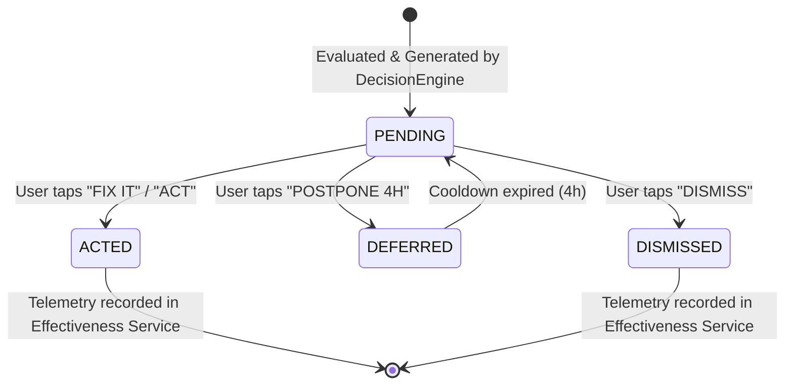

# TESS Phase 14.7 Learning Guide: Proactive Intelligence & Intervention Integration

## 1. Executive Summary & Paradigm Shift: From Prediction to Actionable Agency

In Phase 14.6, TESS became a **Personal Future Simulator**, projecting likely trajectory outcomes, horizons, probabilities, and confidence levels. However, simply observing future risks does not alter reality.

**Phase 14.7 completes the cybernetic loop** by introducing **Proactive Intelligence & Actionable Interventions**:
- **Prediction** answers: *"What is likely to happen if no action is taken?"*
- **Intervention** answers: *"What specific high-leverage action will bend this trajectory toward a positive outcome, and is it worth the effort?"*

```
┌────────────────────────────────────────────────────────────────────────┐
│                        TESS FLUTTER CLIENT                             │
├────────────────────────────────────────────────────────────────────────┤
│                 InterventionsScreen (Proactive Command Center)         │
│ ┌────────────────────────────────────────────────────────────────────┐ │
│ │  Mascot Cognitive Reactive State (INTERVENING / PLANNING / ATTENTION)│
│ └────────────────────────────────────────────────────────────────────┘ │
│ ┌───────────────────────────┬────────────────────────────────────────┐ │
│ │  ACTIVE RECOMMENDATIONS   │  INTERVENTION EFFECTIVENESS            │ │
│ │  - Urgency & Value Score  │  - Acceptance & Conversion Rate        │ │
│ │  - Triggering Prediction  │  - Outcome Improvement Metric          │ │
│ │  - Explicit Action Levers │  - Empirical Calibration               │ │
│ └─────────────┬─────────────┴────────────────────────────────────────┘ │
└───────────────┼────────────────────────────────────────────────────────┘
                │ HTTP / REST (Bearer JWT Auth)
                ▼
┌────────────────────────────────────────────────────────────────────────┐
│                        CORE NETWORK LAYER                              │
│  - InterventionService                                                 │
│  - ApiClient (Authenticated Dio/Http Client)                           │
│  - Idempotency & In-flight State Locking (_submittingIds)             │
└───────────────┼────────────────────────────────────────────────────────┘
                │
                ▼
┌────────────────────────────────────────────────────────────────────────┐
│                 FASTAPI PROACTIVE & DECISION BACKEND                   │
│  - GET  /api/v1/proactive/interventions                                │
│  - POST /api/v1/proactive/evaluate                                     │
│  - POST /api/v1/proactive/interventions/{id}/respond                   │
│  - GET  /api/v1/future/intervention-effectiveness                      │
└────────────────────────────────────────────────────────────────────────┘
```

---

## 2. Core Concepts & Mathematical Foundations

### 2.1 The Value Scoring Model
Interventions are not generated indiscriminately. TESS employs an algorithmic **Value Scorer** to prioritize recommendations:

$$\text{Value Score} = \frac{\text{Expected Impact} \times P(\text{Success})}{\text{Cognitive or Physical Effort}}$$

- **Expected Impact**: Magnitude of trajectory improvement if the action is taken ($0.0 \to 1.0$).
- **$P(\text{Success})$**: Historical conversion rate of similar actions ($0.0 \to 1.0$).
- **Cognitive / Physical Effort**: Estimated cost required to execute the lever.

Interventions with higher value scores are surfaced with elevated priority and urgency badges (`CRITICAL`, `HIGH`, `MEDIUM`, `LOW`).

### 2.2 The Action Decision State Machine
Every intervention progresses through an explicit, deterministic state machine:



- **ACTED**: The user executes or adopts the proposed remedy. This triggers immediate Mascot transition to `MascotState.planning`.
- **DEFERRED (LATER)**: Postpones the recommendation (default 4 hours) to prevent cognitive overload.
- **DISMISSED**: The user explicitly rejects the recommendation. The model registers this negative signal to adapt future thresholds.

---

## 3. Mascot Reactive Emotional Intelligence

TESS's companion Mascot is visually coupled to the user's active trajectory and decision workflow:

| Mascot State | Mascot Face | Color Accent | Triggering Condition |
|---|---|---|---|
| `MascotState.intervening` | `(•_•)` | Amber / Warning | Pending proactive recommendations require user decision |
| `MascotState.planning` | `[o_o]` | Cyan / Accent | User selected "FIX IT", plan or action is being registered |
| `MascotState.attention` | `(!_!)` | Red / Error | High or Critical urgency intervention requires immediate focus |
| `MascotState.thinking` | `(._.)` | Cyan / Accent | Evaluating predictions or background analysis active |
| `MascotState.idle` | `(^-^)` | Primary / Neutral | No pending interventions, nominal trajectory |

---

## 4. Frontend Architecture & Safeguards

### 4.1 In-Flight Action Locking (Preventing Race Conditions)
To prevent accidental double-taps and duplicate server transactions, `InterventionsScreenState` tracks in-flight request IDs:

```dart
final Set<String> _submittingIds = {};

Future<void> _respond(InterventionModel item, String action) async {
  if (_submittingIds.contains(item.id)) return; // Guard against race condition

  setState(() {
    _submittingIds.add(item.id);
    _mascotState = action == 'ACTED' ? MascotState.planning : MascotState.intervening;
  });

  try {
    await widget.service.respondToIntervention(item.id, action);
    // Success: update local state & show feedback
  } finally {
    if (mounted) {
      setState(() => _submittingIds.remove(item.id));
    }
  }
}
```

### 4.2 Epistemic Honesty in Feedback
- If effectiveness data shows low sample count ($N < 5$), the UI indicates that baseline confidence is preliminary.
- Supporting evidence and triggering prediction IDs are transparently displayed so the user understands *why* an intervention was generated.
- No automated actions are taken without explicit user consent.

---

## 5. Verification & Learning Exercises

1. **Verify State Transitions**:
   Navigate to the Interventions screen (`/interventions` or via bolt icon in `FuturesScreen`). Notice how the Mascot reflects `INTERVENING` when pending items exist.
2. **Execute an Action**:
   Tap "FIX IT" on any pending recommendation. Confirm the button disables immediately, the status transitions to `ACTED`, and the Mascot transitions to `[o_o]` (Planning).
3. **Verify Postponement**:
   Tap "LATER". Verify the status changes to `DEFERRED` and the item is scheduled for a 4-hour re-evaluation.
