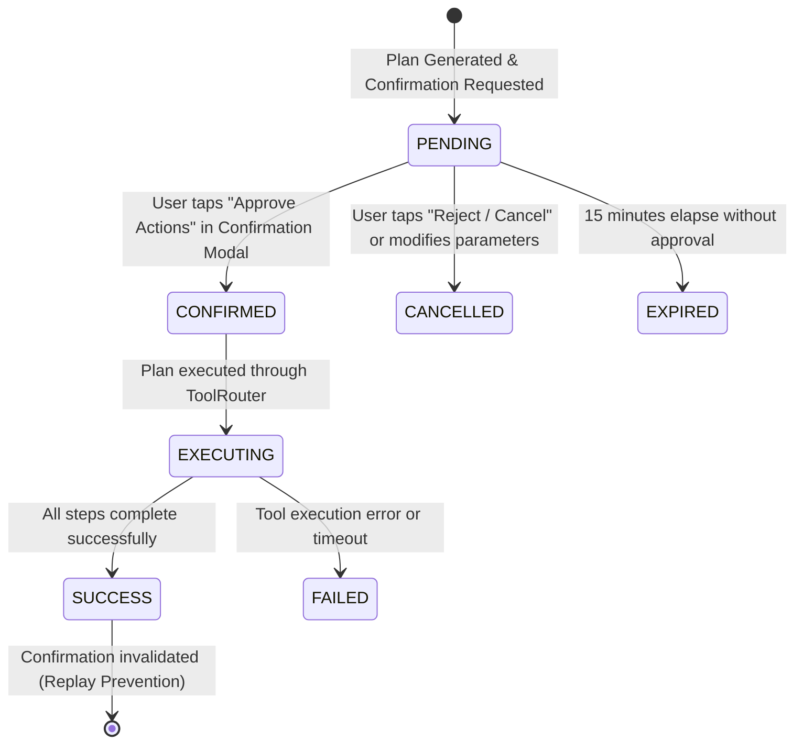

# TESS Phase 14.8 Learning Guide: Agent Intelligence & Action Execution Integration

## 1. Executive Summary & Paradigm Shift: From Observation to Action Execution

In Phase 14.6, TESS became a **Personal Future Simulator**, projecting likely trajectory outcomes. In Phase 14.7, TESS introduced **Proactive Interventions**, recommending high-leverage corrective levers.

**Phase 14.8 completes the autonomy loop** by integrating the **TESS Agent & Action Execution Layer**:
- **Trajectory Simulator (14.6)**: *"Where is my workflow heading?"*
- **Intervention Engine (14.7)**: *"What strategy should I adopt to avert negative outcomes?"*
- **Agent Intelligence (14.8)**: *"Plan the exact sequential operations, verify permissions, request user authorization, and execute the approved plan."*

```
┌────────────────────────────────────────────────────────────────────────┐
│                        TESS FLUTTER CLIENT                             │
├────────────────────────────────────────────────────────────────────────┤
│                 AgentScreen (Autonomous Action Center)                │
│ ┌────────────────────────────────────────────────────────────────────┐ │
│ │  Mascot Cognitive Reactive State (THINKING / PLANNING / ATTENTION) │ │
│ └────────────────────────────────────────────────────────────────────┘ │
│ ┌───────────────────────────┬────────────────────────────────────────┐ │
│ │  OBJECTIVE COMPOSER       │  ACTIVE PLAN & AUDIT TRAIL             │ │
│ │  - Natural Language Input │  - Step Review & Risk Level Badges     │ │
│ │  - Suggestions & Prompts  │  - Safe Parameter Display (No Leaks)   │ │
│ │  - Client-side Validation │  - Confirmation Dialog & Fingerprints  │ │
│ └─────────────┬─────────────┴────────────────────────────────────────┘ │
└───────────────┼────────────────────────────────────────────────────────┘
                │ HTTP / REST (Bearer JWT Auth)
                ▼
┌────────────────────────────────────────────────────────────────────────┐
│                        CORE NETWORK LAYER                              │
│  - AgentService                                                        │
│  - ApiClient (Authenticated Http Client)                               │
│  - In-flight Duplicate Execution Guard                                │
└───────────────┼────────────────────────────────────────────────────────┘
                │
                ▼
┌────────────────────────────────────────────────────────────────────────┐
│                      FASTAPI AGENT SUBSYSTEM                           │
│  - POST /api/v1/agent/objectives           (AgentPlanner)              │
│  - GET  /api/v1/agent/plans                (Audit History)             │
│  - GET  /api/v1/agent/plans/{id}           (Plan & Merged Tokens)      │
│  - POST /api/v1/agent/plans/{id}/confirm   (ConfirmationService)       │
│  - POST /api/v1/agent/plans/{id}/cancel    (Cancellation & Revocation) │
│  - POST /api/v1/agent/plans/{id}/execute   (AgentExecutor/ToolRouter)  │
└────────────────────────────────────────────────────────────────────────┘
```

---

## 2. Core Security & Architectural Principles

### 2.1 User-Controlled Agency (No Consequential Actions Without Consent)
The fundamental tenet of TESS is **epistemic safety and human-in-the-loop control**. The agent cannot silently modify external systems:
1. Low-risk operations (e.g., reading a calendar, reading a document) are classified as `LOW` risk and pre-authorized by policy.
2. High-impact operations (e.g., updating an OpenProject worklog, creating calendar events, modifying files, sending emails) are classified as `MEDIUM` or `HIGH` risk.
3. Every `MEDIUM` or `HIGH` risk step generates an `ActionConfirmation` record with a mandatory authorization requirement.

### 2.2 Parameter Fingerprinting ($fp$) & Tamper Resistance
To prevent replay attacks or silent alterations between confirmation and execution, the backend generates an SHA-256 parameter fingerprint:

$$\text{Fingerprint} = \text{SHA-256}(\text{Canonicalized JSON}(\text{Parameters}))[0:16]$$

- If step parameters are altered after confirmation, the fingerprint no longer matches.
- The `ConfirmationService` immediately invalidates the confirmation token and transitions it to `CANCELLED`.
- Upon successful execution, the confirmation token is immediately invalidated to ensure **strict one-time replay prevention**.

### 2.3 Confirmation Lifecycle & Expiration
Every confirmation has a strict expiration window (15 minutes). If the user does not authorize the operation within 15 minutes, the token transitions to `EXPIRED` and re-planning is required.



---

## 3. Mascot Reactive Emotional Intelligence in Agent Workflows

The companion Mascot visually mirrors the agent's internal cognitive state:

| Mascot State | Mascot Face | Color Accent | Triggering Condition |
|---|---|---|---|
| `MascotState.thinking` | `(._.)` | Cyan / Accent | Agent planner synthesizing tool steps from natural language objective |
| `MascotState.attention` | `(!_!)` | Red / Error | High-risk operations require security confirmation or execution failed |
| `MascotState.planning` | `[o_o]` | Cyan / Accent | Active plan executing sequential tools through `ToolRouter` |
| `MascotState.happy` | `(^-^)` | Green / Success | Plan execution verified and completed successfully |
| `MascotState.idle` | `(•_•)` | Primary / Neutral | Agent standing by for user directives |

---

## 4. Connecting Proactive Interventions to Agent Actions

Phase 14.7 proactive recommendations seamlessly hand off to Phase 14.8 agent objectives:
1. An intervention flags a trajectory issue (e.g., *"Work package #402 overdue"*).
2. The user accepts the recommendation (`ACTED`).
3. The user can tap **`PLAN WITH AGENT`** to open `AgentScreen` with a pre-filled objective.
4. **Epistemic Isolation**: The agent formulates a deterministic plan, but **does not execute it automatically**. The user reviews the parameters, confirms the security token, and triggers execution.

---

## 5. Verification & Hands-on Learning Exercises

1. **Test Objective Formulation**:
   Navigate to `Agent Core` via the brain/psychology icon in the AppBar. Select the preset suggestion: *"Update my OpenProject worklog: 2 hours on task 1"*. Tap **Generate Action Plan**.
2. **Inspect Safe Parameters & Risk Badges**:
   Verify that the step displays `UPDATE WORKLOG`, `MEDIUM RISK`, target resource `Task #1`, and the parameter fingerprint (`fp:xxxx`). Verify that internal tokens or passwords are never displayed.
3. **Execute Confirmation & Execution**:
   Tap **Approve & Confirm** to open the Security Authorization Sheet. Tap **Approve Actions**. Verify the status transitions to `CONFIRMED` and the **Execute Approved Plan** button unlocks.
4. **Inspect Audit History**:
   Switch to the **AUDIT HISTORY** tab to view historical plans, statuses, and execution timestamps.
