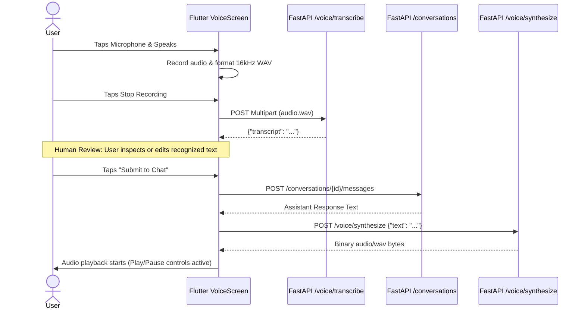

# TESS Phase 14.9 Learning Guide: Voice & Device Intelligence Integration

## 1. Executive Summary & Multimodal Evolution

In Phases 14.1 through 14.8, TESS was developed as a text-first, predictive, and agent-driven mobile client.

**Phase 14.9 elevates TESS into a Multimodal AI Companion**, bridging speech, hearing, device notification identity, and vision screen understanding:
- **Speech-to-Text (STT)**: Speaks natural language commands that are transcribed using Whisper.
- **Human-in-the-Loop Review**: Allows the user to inspect and edit recognized speech before submitting.
- **Conversational Chat Bridge**: Feeds verified speech into the persistent conversation and memory system.
- **Text-to-Speech (TTS)**: Synthesizes conversational responses into WAV audio with play/pause/stop playback controls.
- **Device Identity & Notifications**: Registers the device token with the backend for proactive push alerts.
- **Consented Screen Understanding**: Allows user-authorized vision AI analysis of active display context with strict privacy guards.

```
┌────────────────────────────────────────────────────────────────────────┐
│                        TESS FLUTTER CLIENT                             │
├────────────────────────────────────────────────────────────────────────┤
│                 VoiceScreen (Multimodal Command Center)                │
│ ┌────────────────────────────────────────────────────────────────────┐ │
│ │  Mascot Cognitive Reactive State (LISTENING / THINKING / HAPPY)    │ │
│ └────────────────────────────────────────────────────────────────────┘ │
│ ┌───────────────────────────┬────────────────────────────────────────┐ │
│ │  SPEECH & AUDIO LOOP      │  DEVICE & VISION INTELLIGENCE          │ │
│ │  - 16kHz WAV Audio Record │  - Device Identity Registration        │ │
│ │  - Whisper STT Review/Edit│  - Push Notification Authorization     │ │
│ │  - TTS Response Player    │  - Consented Screen Context Vision AI  │ │
│ └─────────────┬─────────────┴────────────────────────────────────────┘ │
└───────────────┼────────────────────────────────────────────────────────┘
                │ HTTP / REST / Multipart (Bearer JWT Auth)
                ▼
┌────────────────────────────────────────────────────────────────────────┐
│                        CORE NETWORK LAYER                              │
│  - VoiceApiService (STT, TTS, Interact)                                │
│  - DeviceNotificationService (/devices/register, /devices)             │
│  - ScreenAnalysisService (/screen/analyze with Consent Guard)          │
│  - ApiClient (postMultipart, postForBytes, Token Injection)            │
└───────────────┼────────────────────────────────────────────────────────┘
                │
                ▼
┌────────────────────────────────────────────────────────────────────────┐
│                      FASTAPI MULTIMODAL BACKEND                        │
│  - POST /api/v1/voice/transcribe          (Whisper STT)                │
│  - POST /api/v1/voice/synthesize          (TTS pyttsx3 / WAV Bytes)    │
│  - POST /api/v1/voice/interact            (Full Conversational Loop)   │
│  - POST /api/v1/devices/register          (User Device Registration)   │
│  - GET  /api/v1/devices                   (Device Telemetry Query)     │
│  - POST /api/v1/screen/analyze            (Vision LLM Understanding)   │
└────────────────────────────────────────────────────────────────────────┘
```

---

## 2. Audio Engineering & RIFF WAV Specification

Speech models (such as Whisper) require standardized audio formats. TESS generates a compliant **RIFF WAV (16kHz 16-bit Mono PCM)** header directly in Dart:

```
00-03: 'RIFF' Chunk Identifier
04-07: ChunkSize (36 + dataSize) [Little-Endian 32-bit]
08-11: 'WAVE' Format Identifier
12-15: 'fmt ' Sub-chunk Identifier
16-19: Subchunk1Size (16 for PCM)
20-21: AudioFormat (1 = Uncompressed PCM)
22-23: NumChannels (1 = Mono)
24-27: SampleRate (16,000 Hz)
28-31: ByteRate (16,000 * 1 * 16/8 = 32,000 bytes/sec)
32-33: BlockAlign (1 * 16/8 = 2 bytes)
34-35: BitsPerSample (16 bits)
36-39: 'data' Sub-chunk Identifier
40-43: Subchunk2Size (data length in bytes)
44+  : Raw 16-bit PCM Audio Samples
```

### 2.1 Audio Duration & Sample Rate Mathematical Relation
For a recording of duration $T$ seconds at sample rate $f_s = 16{,}000\text{ Hz}$ with 16-bit depth ($2\text{ bytes/sample}$) and 1 channel:

$$\text{Data Size (bytes)} = T \times 16{,}000 \times 2 = T \times 32{,}000$$

The `AudioRecorderService` enforces a minimum duration threshold of $200\text{ ms}$ ($\ge 6{,}400\text{ bytes}$) to discard accidental noise taps before initiating network transcription.

---

## 3. Epistemic Human-in-the-Loop Voice Loop

In accordance with TESS safety protocols, speech is **never dispatched silently**:



---

## 4. Privacy & Consented Screen Understanding

Vision AI screen analysis operates under strict privacy constraints:
1. **Explicit Consent**: The client requires explicit user approval before capturing screen bytes. If unconsented, `ScreenAnalysisService` immediately throws an authorization error without invoking network endpoints.
2. **Format & Size Validation**: Payload is verified against PNG (`89 50 4E 47`) and JPEG (`FF D8 FF`) file headers and restricted to $\le 10\text{ MB}$.
3. **No Continuous or Passive Capture**: Analysis only occurs on intentional, explicit user initiation.

---

## 5. Device Lifecycle & Resource Cleanup

To prevent audio hardware locks and battery drain:
- `WidgetsBindingObserver` listens for `AppLifecycleState.paused` and `AppLifecycleState.inactive`.
- Recording timers and playback tickers are automatically paused or cancelled when the app moves to the background.
- On user logout or session termination, cached device tokens and audio buffers are purged.

