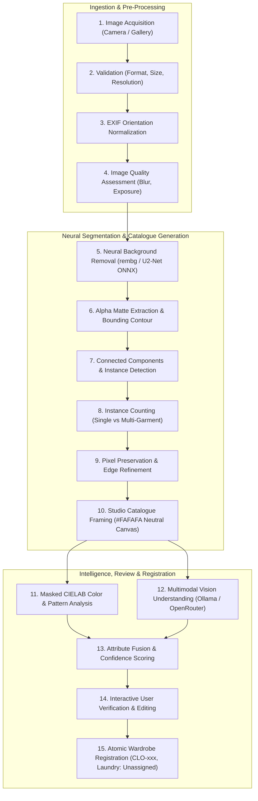

# TESS Smart Capture — Phase 3.1 Architecture Specification
## Multi-Stage Multimodal AI Garment Understanding, Segmentation & Catalogue Generation

**Product:** TESS Wardrobe Intelligence / Clothes Organizer  
**Version:** 1.0  
**Phase:** 3.1 (Smart Capture Production AI Re-Engineering)  
**Date:** November 24, 2026  

---

## 1. Architectural Philosophy

Smart Capture is designed around a fundamental core principle:
> **"AI must accurately understand, isolate, and represent the user's actual physical garments — never hallucinating, redesigning, or slicing real clothes into artificial pieces."**

The previous implementation relied on a fragile heuristic (`aspect_ratio >= 1.25`) that sliced single long garments (such as Kurtas or Dresses) in half and averaged full-image bounding boxes into inaccurate color names.

Phase 3.1 replaces this heuristic with a modular, production-grade 15-stage pipeline separating:
1. **Physical Object Isolation** (Neural U2-Net / rembg segmentation).
2. **Object Instance Geometry** (OpenCV connected components and bounding contour analysis).
3. **Masked Color Science** (CIELAB Delta-E analysis on alpha-isolated garment pixels only).
4. **Multimodal Semantic Understanding** (Vision-Language model identifying garment type, neckline, sleeves, and pattern).
5. **Studio Catalogue Composition** (Centering isolated garment pixels onto a neutral studio canvas without pixel modification).

---

## 2. The 15-Stage Production Pipeline



---

## 3. Detailed Stage Specifications

### Stage 1–4: Ingestion, Validation & Normalization
1. **Acquisition**: Images ingested via Flutter `ImagePicker` (camera or gallery) as JPEG/PNG/WebP.
2. **Validation**: Enforces minimum dimensions ($200 \times 200$), file size limits ($\le 25\text{MB}$), and decodability.
3. **EXIF Normalization**: Automatically applies `PIL.ImageOps.exif_transpose` so smartphone portrait/landscape sensor orientations are corrected before downstream inference.
4. **Quality Assessment**: Computes Laplacian variance (blur detection) and histogram exposure bounds (overexposure / extreme underexposure). Warns user if image quality is degraded.

### Stage 5–8: Neural Segmentation & Instance Isolation
5. **Neural Background Removal**: Ingests normalized image into `rembg` (powered by U2-Net ONNX runtime). Produces a full-resolution 4-channel `RGBA` transparent image where background pixels have $\alpha = 0$.
6. **Alpha Matte Extraction**: Thresholds alpha at $\alpha > 50$ to generate a clean binary garment silhouette.
7. **Connected Components Analysis**: Runs OpenCV `cv2.connectedComponentsWithStats` on the cleaned binary mask.
8. **Instance Counting**:
   - Evaluates significant component areas ($> 4\%$ of total image area).
   - If **ONE continuous component** exists (e.g. a Kurta, dress, shirt, or jacket), exactly **ONE garment candidate** is produced. The kurta is NEVER sliced into top and bottom.
   - If **MULTIPLE disconnected components** exist (e.g. shirt and jeans laid separately or outfit set), distinct bounding boxes and individual transparent masks are extracted for each component.

### Stage 9–10: Studio Catalogue Composition
9. **Pixel Preservation**: The isolated garment pixels are taken directly from the original photo. No diffusion repainting or AI redesign is applied; embroidery, texture, wrinkles, and buttons are 100% authentic.
10. **Catalogue Framing**: The garment is placed centered on a clean studio neutral background (`#FAFAFA`) with consistent $10\%$ margins using Lanczos resampling, resulting in a crisp $800 \times 800$ catalogue image.

### Stage 11–13: Masked Color Science & Multimodal Vision
11. **Masked CIELAB Color Analysis**:
    - Evaluates **ONLY pixels where $\alpha > 100$**, completely excluding the background floor, walls, and shadows.
    - Converts RGB to CIELAB space.
    - Clusters colors to extract:
      - Primary Color (dominant cluster).
      - Secondary Color (secondary cluster $\ge 15\%$ presence).
      - Accent Colors (clusters between $5\%$ and $15\%$).
      - Pattern detection (color variance and edge density).
12. **Multimodal Vision Model**:
    - Dispatches original crop + masked cutout to vision model (Local Ollama `moondream` or Cloud OpenRouter / Gemini Vision).
    - Extracts structured semantics:
      - Category & Subcategory (`Ethnic Wear` &rarr; `Kurta`, `Tops` &rarr; `Shirt`, etc.).
      - Sleeve Length (`Sleeveless`, `Short Sleeves`, `Three-Quarter Sleeves`, `Full Sleeves`, `Uncertain`).
      - Neckline (`Round`, `V-neck`, `Mandarin / Nehru`, `Collar`, `Square`, `Boat`, `Uncertain`).
      - Pattern & Fabric Visual Appearance (`Cotton-like`, `Silk-like`, `Linen-like`, `Denim-like`, `Uncertain`).
13. **Attribute Fusion & Confidence Scoring**:
    - Cross-references pixel color telemetry with vision model predictions.
    - Emits explicit confidence scores (`HIGH`, `MEDIUM`, `LOW`, `UNCERTAIN`) for each field.
    - Formulates human-readable uncertainty notes for any low-confidence attributes.

### Stage 14–15: Verification & Registration
14. **User Verification**: Flutter `CaptureReviewScreen` renders before/after split-screen, confidence badges, and candidate cards with individual attribute editors.
15. **Wardrobe Registration**: Approved candidates are registered atomically into `wardrobe_garments` with sequential `CLO-xxx` IDs. **`laundry_status` is explicitly set to `null` (UNASSIGNED)** in accordance with TESS laundry safety rules.

---

## 4. Provider Layer Architecture

```text
                        GarmentVisionProvider (Interface)
                                      ▲
           ┌──────────────────────────┼──────────────────────────┐
           │                          │                          │
  OllamaVisionProvider      OpenRouterVisionProvider    LocalNeuralVisionProvider
 (Local moondream:latest)    (Cloud Gemini 2.0 / Flash)     (rembg + CIELAB CV)
```

- **Local-First Default**: System prioritizes local execution via Ollama and local ONNX runtime for total privacy and zero API costs.
- **Cloud Fallback / Override**: If `OPENROUTER_API_KEY` or `GEMINI_API_KEY` is present, rich multimodal reasoning can be activated seamlessly.
- **Fail-Safe Deterministic**: If vision LLM is offline or times out, the local neural segmentation (`rembg`) + CIELAB color clustering provides reliable detection without splitting garments.

