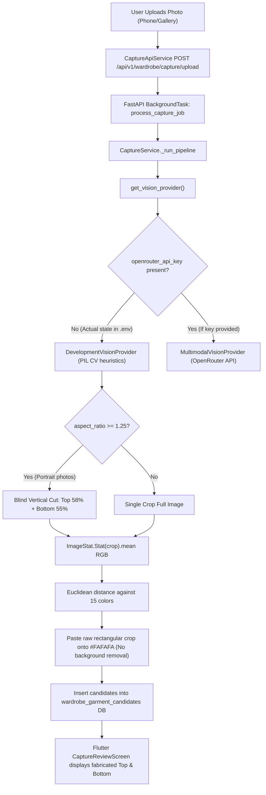

# TESS Smart Capture — Phase 3.1 Technical Audit Report
## Deep-Dive Architectural Investigation of Garment Detection, Segmentation & Attribute Extraction Failures

**Product:** TESS Wardrobe Intelligence / Clothes Organizer  
**Version:** 1.0  
**Phase:** 3.1 (Smart Capture AI Re-Engineering)  
**Date:** November 24, 2026  
**Auditor:** Antigravity AI Engineering Team  

---

## 1. Executive Summary & Root Cause Findings

An end-to-end technical audit was conducted on the TESS Smart Capture pipeline across the Flutter mobile application (`flutter_app/lib/features/wardrobe/`) and FastAPI backend (`backend/app/services/wardrobe/`).

### Root Causes Discovered

1. **Simulated AI Processing & Silent Fallback**:
   In `backend/.env`, only `AI_PROVIDER=ollama` with text model `llama3.2:1b` was configured; `OPENROUTER_API_KEY` was empty.
   Consequently, `get_vision_provider()` in [vision_provider.py](file:///home/bhavanamj/Desktop/Tess/backend/app/services/wardrobe/vision_provider.py#L419-L428) silently and unconditionally fell back to `DevelopmentVisionProvider`. **Zero vision models were being invoked.**

2. **The "Kurta Split" Root Cause**:
   In `DevelopmentVisionProvider.detect_and_segment` (lines 180–255), the system evaluated image aspect ratio:
   ```python
   aspect_ratio = h / float(w)
   is_multi_garment = aspect_ratio >= 1.25
   ```
   If the aspect ratio was $\ge 1.25$ (which is true for almost every portrait photograph taken on a phone, such as $1440 \times 1919$ with ratio $1.33$), the system mechanically and blindly sliced the image:
   - **Upper 58% of the image** was emitted as a `"Top"` / `"Shirt"` candidate.
   - **Lower 55% of the image** was emitted as a `"Bottoms"` / `"Trousers"` candidate.
   A single physical kurta was thus mechanically severed into two fabricated garment records because of a hardcoded vertical geometry heuristic.

3. **Inaccurate Colour Detection**:
   In `_get_dominant_color_and_stats` (lines 142–162), dominant color was calculated by calling `PIL.ImageStat.Stat(crop_img).mean[:3]`. This averaged the RGB values of the **entire rectangular bounding box**, combining the garment with the floor, bedsheet, shadows, background walls, and ambient lighting. That unsegmented average was then compared using simple Euclidean distance against a static list of only 15 color names.

4. **Zero Background Removal**:
   `_create_studio_catalogue_image` (lines 113–140) did not perform background removal or semantic segmentation. It simply took the raw rectangular crop (with the room background and shadows intact) and pasted it onto a $600 \times 600$ `#FAFAFA` white canvas.

5. **Hallucinated Attributes**:
   Attributes such as sleeve length (`"Short Sleeves"`), neckline (`"Crew Neck"`), and fabric (`"Cotton appearance"`) were hardcoded string constants stamped onto candidate DTOs with static `"HIGH"` confidence scores, regardless of the actual garment in the photo.

---

## 2. Comprehensive 12-Point Technical Audit

### 2.1 Current Processing Architecture


### 2.2 Which AI Models Are Actually Called?
- **Actual Runtime Calls**: **NONE**.
- The FastAPI service called `DevelopmentVisionProvider`, which uses standard Pillow functions (`Image.open`, `Image.crop`, `ImageStat.Stat`, `Image.thumbnail`, `Image.paste`).
- No neural network, vision-language model, or segmentation model was executed.

### 2.3 Is Image Understanding Real or Simulated?
- **Simulated**.
- Garment categorization, color identification, and attribute generation were rule-based heuristics and fixed template dictionaries.
- When an image had portrait aspect ratio, it arbitrarily declared that an outfit of two pieces (Top + Bottom) was present.

### 2.4 Is Segmentation Real?
- **No**.
- There was no pixel-level semantic mask, polygon, or alpha channel generated.
- "Segmentation" was merely a rectangular sub-image crop (`img.crop(top_box)` and `img.crop(bottom_box)`).

### 2.5 Is Background Removal Real?
- **No**.
- The background of the room, bed, hangers, and floor remained completely visible within the rectangular crop.
- The crop was simply placed in the center of an off-white JPEG canvas.

### 2.6 How Garment Boundaries Are Identified
- Currently, garment boundaries are not detected from pixels at all.
- Fixed rectangular slices are applied:
  - Top box: `(0, 0, width, int(height * 0.58))`
  - Bottom box: `(0, int(height * 0.45), width, height)`
- These slices ignore where the garment actually starts and ends, cutting across chest, waist, and sleeves arbitrarily.

### 2.7 How Attributes Are Extracted
- **Category**: Fixed to `"Tops"` for the upper crop and `"Bottoms"` for the lower crop.
- **Subcategory**: Hardcoded to `"Shirt"` and `"Trousers"`.
- **Sleeve Length**: Hardcoded to `"Short Sleeves"`.
- **Neckline**: Hardcoded to `"Crew Neck"`.
- **Fit**: Hardcoded to `"Regular Fit"`.
- **Fabric**: Hardcoded to `"Cotton appearance"`.
- **Confidence Scores**: Falsified as `"HIGH"` (`confidence_scores: {"category": "HIGH", "primary_color": "HIGH"}`).

### 2.8 Why One Kurta Was Classified as Two Garments
- The user's uploaded photograph (`job_036aae3fb6cc.jpg`) has resolution $1440 \times 1919$.
- Aspect ratio: $\frac{1919}{1440} = 1.3326$.
- Because $1.3326 \ge 1.25$, the pipeline assumed a full-body outfit was present and generated two distinct candidate records:
  1. `job_036aae3fb6cc_cand_34181eba9988`: Upper 58% of the kurta labeled as `"Tops / Shirt"`.
  2. `job_036aae3fb6cc_cand_bb337789b6bc`: Lower 55% of the kurta labeled as `"Bottoms / Trousers"`.

### 2.9 Why Colour Detection Is Inaccurate
- The algorithm averaged every pixel in the rectangular crop, including dark shadows behind the kurta, the room floor, and skin tones.
- Full image average RGB was `[75, 36, 46]` (dark brownish black), whereas the actual kurta fabric pixels in isolation are `[132, 64, 81]` (rich berry/burgundy pink).
- The mapping was constrained to a lookup table of only 15 basic colors, unable to represent nuanced shades, pastels, or prints.

### 2.10 Do Processed Images Preserve Garment Details?
- **No**.
- The bottom half of the kurta was chopped off in the top candidate, and the upper collar/sleeves were chopped off in the bottom candidate.
- Because background was not removed, edge details (embroidery, hemlines) were obscured by ambient shadows.

### 2.11 Are Original and Processed Images Stored Correctly?
- **Yes, the filesystem storage architecture is solid**:
  - Originals are stored at `backend/app/media/wardrobe/{user_id}/originals/job_{id}.jpg`.
  - Processed images are stored at `backend/app/media/wardrobe/{user_id}/processed/job_{id}_cand_{id}.jpg`.
  - Crops are stored at `backend/app/media/wardrobe/{user_id}/crops/job_{id}_cand_{id}_crop.jpg`.
  - Originals are preserved and never overwritten.

### 2.12 What Must Change
1. **Remove Hardcoded Aspect-Ratio Slicing**:
   Object detection must evaluate semantic connected components and instance masks. A single garment must produce exactly ONE candidate.
2. **Real Neural Background Removal**:
   Integrate `rembg` (U2-Net ONNX runtime) to compute true alpha masks, separating garment pixels from background cleanly.
3. **Mask-Aware Color Extraction**:
   Color clustering must evaluate ONLY non-zero alpha garment pixels in CIELAB color space, distinguishing primary, secondary, and print colors from the background.
4. **Real Multimodal Vision Integration**:
   Provide genuine vision model integration (Ollama `moondream` locally, plus OpenRouter / Gemini API cloud fallback) with structured Pydantic output.
5. **Accurate Attribute Inference & Uncertainty**:
   Identify actual neckline, sleeve length, pattern, and silhouette from visual understanding, with explicit `UNCERTAIN` or `LOW` confidence flags when occluded.

