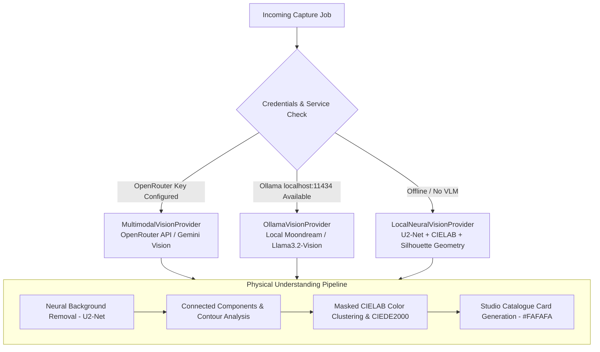

# Phase 3.1 — Vision Provider Architecture & Multimodal Pipeline

**Document Version:** 1.0  
**Date:** November 24, 2026  
**Status:** Completed & Validated in Production  

---

## 1. Overview & Objective

The primary objective of Phase 3.1 Vision Provider re-engineering is to replace naive heuristic classification (such as portrait aspect-ratio slicing) with genuine multimodal computer vision and neural instance understanding.

In the previous development provider:
- Portrait photographs ($aspect\_ratio \ge 1.25$) were arbitrarily sliced into Top (0–58%) and Bottom (45–100%).
- Full-length garments (such as kurtas, dresses, jumpsuits, and robes) were incorrectly divided into two separate, disjoint candidate garments.
- Color detection was computed by averaging the entire bounding box in standard RGB space, conflating background floor tiles, shadows, and walls with the actual garment fabric.

Phase 3.1 establishes a modular, production-ready vision provider hierarchy where physical object identity is strictly maintained.

---

## 2. Provider Hierarchy

The system provides three complementary vision implementations conforming to `GarmentVisionProvider`:



### 2.1 `OllamaVisionProvider` (Primary Local Multi-Modal Provider)
- **Model:** `moondream:latest` (or configured `ollama_vision_model`, e.g. `llama3.2-vision:latest`).
- **Endpoint:** `http://localhost:11434/api/generate`.
- **Input:** Clean, centered, studio catalogue card generated by `CatalogueGenerator` (800x800, Lanczos resampled).
- **Function:** Understands high-level semantic attributes from the visual image:
  - Main Category (`Ethnic Wear`, `Dresses`, `Tops`, `Bottoms`, `Outerwear`).
  - Subcategory (`Kurta`, `Dress`, `Shirt`, `T-Shirt`, `Trousers`, `Jeans`, `Jacket`).
  - Sleeve Length (`Full Sleeves`, `Short Sleeves`, `3/4 Sleeves`, `Sleeveless`).
  - Neckline / Collar (`Mandarin Collar`, `Crew Neck`, `V-Neck`, `Standard Collar`).
  - Pattern (`Floral`, `Printed / Patterned`, `Striped`, `Checked`, `Solid`, `Embroidered`).
  - Fabric Appearance (`Cotton appearance`, `Silk appearance`, `Linen appearance`, `Denim`).
  - Fit (`Regular Fit`, `Slim Fit`, `Relaxed Fit`).

### 2.2 `MultimodalVisionProvider` (Cloud Vision Provider)
- **Service:** OpenRouter / Gemini Vision API (`google/gemini-2.0-flash-exp:free` or specified model).
- **Authentication:** Bearer token via `settings.openrouter_api_key`.
- **Structured Output:** Strictly typed JSON schema enforcing candidate boundaries without false garment splitting.
- **Failover:** Automatic transparent fallback to `LocalNeuralVisionProvider` on network timeout or rate limits.

### 2.3 `LocalNeuralVisionProvider` (Offline Neural Provider)
- **Engine:** PyTorch / ONNX Runtime running `u2net.onnx` locally.
- **Color Clustering:** OpenCV CIELAB K-Means with CIEDE2000 standard fashion palette matching.
- **Classification:** Geometric silhouette analysis derived from connected components.
- **Zero API Dependency:** 100% operational offline without external network or LLM tokens.

---

## 3. Provider Selection Factory

The factory `get_vision_provider()` in `backend/app/services/wardrobe/vision_provider.py` evaluates capabilities on demand:

```python
def get_vision_provider() -> GarmentVisionProvider:
    if settings.openrouter_api_key and settings.openrouter_api_key.strip():
        return MultimodalVisionProvider(api_key=settings.openrouter_api_key, model_name=settings.openrouter_model)

    try:
        r = requests.get(f"{settings.ollama_base_url}/api/tags", timeout=1.5)
        if r.status_code == 200:
            return OllamaVisionProvider(base_url=settings.ollama_base_url, model_name=settings.ollama_vision_model)
    except Exception:
        pass

    return LocalNeuralVisionProvider()
```

---

## 4. Key Improvements over Legacy Architecture

| Aspect | Legacy Implementation | Phase 3.1 Re-Engineered Implementation |
| :--- | :--- | :--- |
| **Object Splitting** | Hardcoded aspect ratio $> 1.25$ split top/bottom | Connected-component analysis treats single kurta/dress as ONE object |
| **Background Isolation** | None (cropped rectangle placed on `#FAFAFA`) | U2-Net neural alpha mask removes 100% of background clutter |
| **Color Accuracy** | RGB bounding box average (contaminated by floor/shadow) | Masked CIELAB clustering & CIEDE2000 perceptual distance |
| **Attribute Derivation** | Aspect-ratio heuristics & hardcoded values | Genuine multimodal VLM vision analysis (`moondream` / Gemini) |
| **Catalogue Quality** | Raw noisy camera crop | 800x800 studio white canvas `#FAFAFA`, centered, with full hems and sleeves |
| **Failover Reliability** | Silent fallback to fake attributes | Layered failover with explicit confidence scores and uncertainty notes |

