# Phase 7: Database Design & Schema Migrations
## Wardrobe Insights, Usage Analytics & Personal Style Intelligence

### 1. Executive Summary

Phase 7 introduces persistent style intelligence and cost-per-wear telemetry to TESS without mutating or breaking existing Wardrobe (Phase 1–2), Smart Capture (Phase 3), Laundry Manager (Phase 4), Outfit Studio (Phase 5), or Outfit Calendar (Phase 6) models.

Migration `006_wardrobe_insights.sql` was authored and registered in `backend/schema.sql`.

---

### 2. Migration Details: `006_wardrobe_insights.sql`

```sql
-- Migration 006: Wardrobe Insights & Personal Style Intelligence
-- Extends wardrobe_items with purchase currency and adds wardrobe_style_preferences table.

-- 1. Extend wardrobe_items table with purchase_currency
ALTER TABLE wardrobe_items
ADD COLUMN IF NOT EXISTS purchase_currency VARCHAR(10) DEFAULT 'INR';

-- 2. Create wardrobe_style_preferences table for storing user style persona and explicit rules
CREATE TABLE IF NOT EXISTS wardrobe_style_preferences (
    id UUID PRIMARY KEY DEFAULT gen_random_uuid(),
    user_id UUID NOT NULL REFERENCES auth.users(id) ON DELETE CASCADE,
    style_persona VARCHAR(100) DEFAULT 'Smart Casual Minimalist',
    preferred_colors TEXT[] DEFAULT '{}',
    preferred_categories TEXT[] DEFAULT '{}',
    preferred_occasions TEXT[] DEFAULT '{}',
    disliked_styles TEXT[] DEFAULT '{}',
    notes TEXT,
    created_at TIMESTAMPTZ DEFAULT NOW(),
    updated_at TIMESTAMPTZ DEFAULT NOW(),
    CONSTRAINT unique_user_style_pref UNIQUE(user_id)
);

-- 3. Row-Level Security (RLS) Policies
ALTER TABLE wardrobe_style_preferences ENABLE ROW LEVEL SECURITY;

CREATE POLICY "Users can view own style preferences"
    ON wardrobe_style_preferences FOR SELECT
    USING (auth.uid() = user_id);

CREATE POLICY "Users can insert own style preferences"
    ON wardrobe_style_preferences FOR INSERT
    WITH CHECK (auth.uid() = user_id);

CREATE POLICY "Users can update own style preferences"
    ON wardrobe_style_preferences FOR UPDATE
    USING (auth.uid() = user_id);

CREATE POLICY "Users can delete own style preferences"
    ON wardrobe_style_preferences FOR DELETE
    USING (auth.uid() = user_id);

-- 4. Analytical Performance Indexes
CREATE INDEX IF NOT EXISTS idx_wardrobe_items_user_wear_count 
    ON wardrobe_items(user_id, wear_count DESC);

CREATE INDEX IF NOT EXISTS idx_wardrobe_items_user_price 
    ON wardrobe_items(user_id, purchase_price) 
    WHERE purchase_price IS NOT NULL;

CREATE INDEX IF NOT EXISTS idx_wardrobe_items_last_worn 
    ON wardrobe_items(user_id, last_worn_date);

CREATE INDEX IF NOT EXISTS idx_style_pref_user 
    ON wardrobe_style_preferences(user_id);
```

---

### 3. Entity Relationships

```mermaid
erDiagram
    USERS ||--o{ WARDROBE_ITEMS : owns
    USERS ||--o| WARDROBE_STYLE_PREFERENCES : configures
    USERS ||--o{ OUTFITS : creates
    USERS ||--o{ OUTFIT_CALENDAR_EVENTS : schedules
    USERS ||--o{ OUTFIT_WEAR_HISTORY : logs
    OUTFITS ||--|{ OUTFIT_ITEMS : contains
    WARDROBE_ITEMS ||--o{ OUTFIT_ITEMS : referenced_in
    WARDROBE_ITEMS ||--o{ OUTFIT_WEAR_HISTORY : logs_wear

    WARDROBE_ITEMS {
        uuid id PK
        uuid user_id FK
        text name
        text main_category
        text primary_color
        numeric purchase_price
        text purchase_currency
        int wear_count
        timestamptz last_worn_date
        text laundry_status
        boolean is_archived
    }

    WARDROBE_STYLE_PREFERENCES {
        uuid id PK
        uuid user_id FK
        text style_persona
        text[] preferred_colors
        text[] preferred_categories
        text[] preferred_occasions
        text notes
        timestamptz updated_at
    }
```



---

### 4. Integrity and Zero-Regression Guarantees

1. **`purchase_currency` Defaults**: Defaults to `'INR'` with non-breaking backwards compatibility.
2. **Safe Fallbacks for Unpriced Items**: `purchase_price` is nullable (`NUMERIC(10,2)`). Items without purchase prices are safely partitioned into `ValueTier.missingPrice` without runtime exceptions or falsified cost per wear.
3. **Cascading Safety**: Dropping or deleting a user cleanly cascades to `wardrobe_style_preferences` via `ON DELETE CASCADE`.
