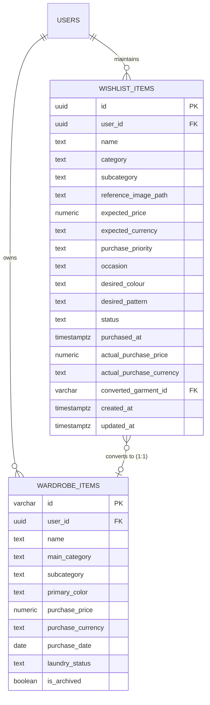

# Phase 8: Database Design & Schema Migrations
## Wardrobe Wishlist & Shopping Intelligence

### 1. Database Schema Migration 007

Migration `007_wardrobe_wishlist.sql` adds the `wishlist_items` table and associates it with `wardrobe_items`.

```sql
-- Migration 007: Wardrobe Wishlist, Shopping Intelligence & Wardrobe Gap Analysis
CREATE TABLE IF NOT EXISTS public.wishlist_items (
    id UUID PRIMARY KEY DEFAULT gen_random_uuid(),
    user_id UUID NOT NULL REFERENCES auth.users(id) ON DELETE CASCADE,
    name VARCHAR(150) NOT NULL,
    category VARCHAR(50) NOT NULL,
    subcategory VARCHAR(50),
    reference_image_path TEXT,
    expected_price NUMERIC(10, 2),
    expected_currency VARCHAR(10) DEFAULT 'INR',
    purchase_priority VARCHAR(20) NOT NULL DEFAULT 'MEDIUM' CHECK (purchase_priority IN ('HIGH', 'MEDIUM', 'LOW')),
    occasion VARCHAR(50),
    desired_colour VARCHAR(50),
    desired_pattern VARCHAR(50),
    description TEXT,
    notes TEXT,
    status VARCHAR(30) NOT NULL DEFAULT 'CONSIDERING' CHECK (status IN ('CONSIDERING', 'SHORTLISTED', 'PURCHASED', 'NOT_INTERESTED')),
    purchased_at TIMESTAMPTZ,
    actual_purchase_price NUMERIC(10, 2),
    actual_purchase_currency VARCHAR(10) DEFAULT 'INR',
    converted_garment_id VARCHAR(50) REFERENCES public.wardrobe_items(id) ON DELETE SET NULL,
    created_at TIMESTAMPTZ NOT NULL DEFAULT NOW(),
    updated_at TIMESTAMPTZ NOT NULL DEFAULT NOW()
);

-- Row-Level Security Policies
ALTER TABLE public.wishlist_items ENABLE ROW LEVEL SECURITY;

CREATE POLICY "Users can view own wishlist items"
    ON public.wishlist_items FOR SELECT
    USING (auth.uid() = user_id);

CREATE POLICY "Users can insert own wishlist items"
    ON public.wishlist_items FOR INSERT
    WITH CHECK (auth.uid() = user_id);

CREATE POLICY "Users can update own wishlist items"
    ON public.wishlist_items FOR UPDATE
    USING (auth.uid() = user_id);

CREATE POLICY "Users can delete own wishlist items"
    ON public.wishlist_items FOR DELETE
    USING (auth.uid() = user_id);

-- Performance Indexes
CREATE INDEX IF NOT EXISTS idx_wishlist_items_user_status
    ON public.wishlist_items(user_id, status);

CREATE INDEX IF NOT EXISTS idx_wishlist_items_user_priority
    ON public.wishlist_items(user_id, purchase_priority);

CREATE INDEX IF NOT EXISTS idx_wishlist_items_converted_garment
    ON public.wishlist_items(converted_garment_id);

CREATE INDEX IF NOT EXISTS idx_wishlist_items_created
    ON public.wishlist_items(user_id, created_at DESC);
```

---

### 2. Entity-Relationship Model



---

### 3. Key Design Principles

1. **Separation of Financial Realities**:
   - `expected_price`: Estimated budget planned before buying.
   - `actual_purchase_price`: Actual amount paid upon purchase confirmation.
   - Stored independently on `wishlist_items` so historical variance can be audited without overwriting original expectations.
2. **Idempotent 1-to-1 Linkage**:
   - `converted_garment_id` uniquely records which garment was born from this wishlist item.
   - Repeated conversion requests return the existing linked garment without creating duplicate records.
3. **Safe Deletion & Archival**:
   - `ON DELETE SET NULL` ensures deleting a wardrobe garment does not delete wishlist history.
   - Cascading user deletion (`ON DELETE CASCADE`) ensures clean tenant isolation.

