# TESS Wardrobe Intelligence — Phase 8: Wishlist-to-Wardrobe Conversion Specification

**Product:** TESS Wardrobe Intelligence / Clothes Organizer  
**Version:** 1.0  
**Phase:** 8 (Wardrobe Wishlist, Shopping Intelligence & Wardrobe Gap Analysis)  
**Date:** November 24, 2026  

---

## 1. Overview & Conversion Philosophy

The Wishlist-to-Wardrobe conversion process represents the bridge between **aspirational acquisition intent** and **physical garment ownership**.

In accordance with TESS's core principles:
> **"Never assume a newly acquired garment is clean merely because it is new or its status is unknown. All garments entering My Wardrobe must have an unassigned laundry status until physically inspected or laundered."**

When a user converts a wishlist item into a registered wardrobe garment, TESS ensures:
1. **Idempotency & Collision-Free IDs**: Once converted, a wishlist item cannot be re-converted, preventing duplicate garment entries. Sequential `CLO-xxx` garment IDs are generated without race conditions.
2. **Economic Transparency**: The original estimated price (`expected_price`) is permanently retained on the wishlist item record for historical accuracy, while the user's real expenditure (`actual_purchase_price`) is saved on both the conversion record and the newly registered `wardrobe_garments` entry.
3. **Unassigned Laundry Safety**: The newly registered garment is created with `laundry_status = null` (UNASSIGNED). It must never default to `CLEAN`.
4. **Lifecycle Attribution**: The wishlist item's status transitions to `CONVERTED`, linking directly to `converted_garment_id` and recording `converted_at`.

---

## 2. Conversion Architecture & Data Flow

```mermaid
sequenceDiagram
    autonumber
    actor User
    participant UI as WishlistConversionScreen
    participant Controller as WishlistController
    participant Repo as WishlistRepository
    participant API as FastAPI /api/v1/wardrobe/wishlist
    participant DB as Supabase PostgreSQL

    User->>UI: Taps "I Bought This" / "Convert to Wardrobe"
    UI->>User: Prompts for actual purchase price, purchase date & store name
    User->>UI: Submits purchase details ($89.00, today, "Nordstrom")
    UI->>Controller: convertToWardrobe(id, actualPrice, store, date)
    Controller->>Repo: convertToWardrobe(...)
    Repo->>API: POST /items/{id}/convert-to-wardrobe
    
    rect rgb(17, 20, 38)
        Note over API,DB: Backend Transaction & Idempotency Check
        API->>DB: SELECT * FROM wishlist_items WHERE id = ? FOR UPDATE
        alt Already Converted
            API-->>Controller: HTTP 400 "Item has already been converted to garment CLO-xxx"
        else Active / Pending Item
            API->>DB: Generate next sequential garment ID (e.g. CLO-019)
            API->>DB: INSERT INTO wardrobe_garments (id, name, category, color, purchase_price, laundry_status, ...) VALUES (CLO-019, ..., 89.00, NULL, ...)
            API->>DB: UPDATE wishlist_items SET status = 'CONVERTED', converted_garment_id = 'CLO-019', actual_purchase_price = 89.00, converted_at = NOW() WHERE id = ?
            API-->>Repo: 200 OK { garment: {...}, wishlist_item: {...} }
        end
    end
    
    Repo-->>Controller: Garment + Updated WishlistItem
    Controller->>UI: Success feedback with link to Garment Inspector
    UI->>User: Display success banner ("CLO-019 added to Wardrobe with Unassigned laundry status")
```



---

## 3. Detailed Field Mapping

| Source Field (`wishlist_items`) | Target Field (`wardrobe_garments`) | Transformation & Safety Rule |
|:---|:---|:---|
| `name` | `name` | Exact string copy |
| `category` | `category` | Matched to existing system category enum (`Tops`, `Bottoms`, `Dresses`, `Outerwear`, etc.) |
| `subcategory` | `subcategory` | Exact string copy if present |
| `color` | `color` | Primary color copied |
| `secondary_color` | `secondary_color` | Secondary color copied if present |
| `season` | `season` | Inherited or default `All Season` |
| `formality` | `occasions` | Mapped into occasion array (e.g., `['Casual', 'Work']`) |
| `notes` | `notes` | Inherited with conversion provenance appended: `"Converted from Wishlist on YYYY-MM-DD"` |
| `image_url` | `image_url` | Transferred to garment image reference |
| **`expected_price`** | *(Not transferred to garment)* | Retained exclusively on `wishlist_items` for budget vs actual analysis |
| **User input `actual_purchase_price`** | **`purchase_price`** | Set to actual paid amount (defaults to `expected_price` if not overridden) |
| **User input `store_name`** | **`brand` / `source`** | Stored in garment metadata / brand |
| **User input `purchase_date`** | **`purchase_date`** | Defaults to today's UTC timestamp |
| *(None)* | **`laundry_status`** | **Explicitly `null` (UNASSIGNED)** — Never assumed clean |
| *(None)* | **`wear_count`** | **Explicitly `0`** |
| *(None)* | **`wash_count`** | **Explicitly `0`** |
| *(None)* | **`id`** | Next sequential `CLO-xxx` unique identifier |

---

## 4. Idempotency & Error Handling

### 4.1 Duplicate Conversion Protection
If a network retry or rapid double-tap triggers a duplicate conversion request:
```python
if existing_item.status == "CONVERTED" or existing_item.converted_garment_id:
    raise HTTPException(
        status_code=400,
        detail=f"Wishlist item '{item_id}' has already been converted to garment '{existing_item.converted_garment_id}'"
    )
```
The client controller captures this response gracefully and displays an informational message rather than an unhandled error.

### 4.2 Rollback Safety
In Supabase/PostgreSQL, garment insertion and wishlist status updates are executed within a single transaction boundary:
- If garment insertion fails (e.g., database constraint violation or network timeout), the wishlist item status remains unchanged (`ACTIVE` or `PURCHASED`).
- The item can be safely retried.

### 4.3 Offline-First Synthesis & Queueing
When operating in an offline environment:
1. `WishlistRepositoryImpl` synthesizes a local conversion by registering a provisional garment with ID `CLO-OFFLINE-{timestamp}` and `laundryStatus: null`.
2. Marks the local cached wishlist item as `convertedGarmentId: CLO-OFFLINE-{timestamp}` and `status: WishlistStatus.converted`.
3. Queues the mutation to be synchronized with the FastAPI backend once network connectivity is re-established.

---

## 5. UI/UX Flow in `WishlistConversionScreen`

1. **Pre-populated Inputs**:
   - Estimated Price pre-filled as placeholder.
   - Default Purchase Date set to today.
   - Retailer pre-filled if previously specified on wishlist item.
2. **Clear Feedback**:
   - Highlight banner informing user that the item will be added to My Wardrobe in **Unassigned** laundry status.
   - Reminder that cost-per-wear tracking will automatically initialize at `0 wears`.
3. **Immediate Post-Conversion Routing**:
   - Option A: "View in My Wardrobe" (opens Garment Inspector for the newly created `CLO-xxx`).
   - Option B: "Return to Wishlist" (updates list view with converted badge).
