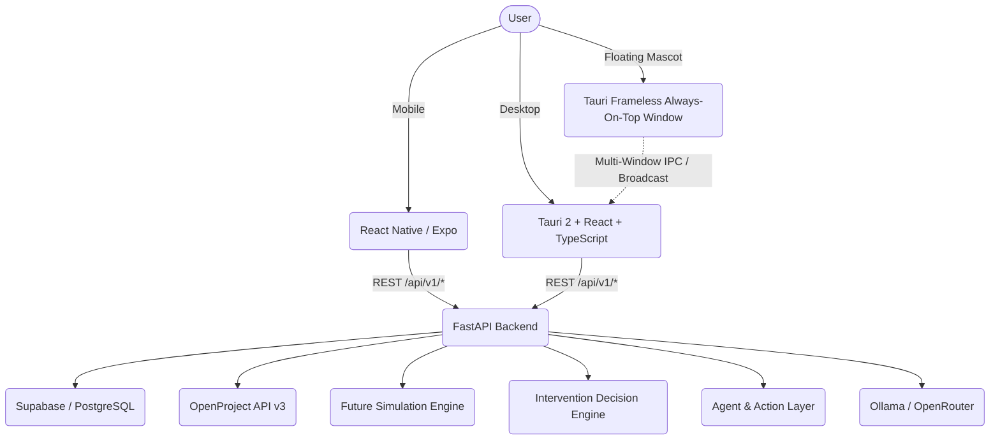

# TESS Architecture (Phase 7 — Cross-Device Companion)

## Overview
TESS is a personal AI companion designed to provide seamless productivity monitoring, future trajectory simulation, proactive interventions, and action execution across multiple devices. 

Phase 7 introduces the **Cross-Device Companion**, enabling TESS to run simultaneously as an Android mobile app and a full desktop application with a persistent floating AI mascot on Linux and Windows.

## System Architecture

## Cross-Device Components

1. **Android Mobile Application (`mobile/`)**:
   - React Native + Expo.
   - Provides on-the-go chat, productivity glances, future trajectory views, and action reviews.

2. **Full Desktop Application (`desktop/`)**:
   - Tauri 2 + React 18 + TypeScript + Vite.
   - Dark-theme workstation interface with purple accents (`#8B5CF6`).
   - 8 core navigation panels: Home, Chat, Tasks, Futures, Interventions, Agent Activity, Memory, and Settings.
   - Native desktop notifications for proactive interventions and deadline alerts.

3. **Floating AI Mascot (`desktop/src/mascot/`)**:
   - Compact, draggable, frameless window with transparent background.
   - Stays always-on-top while working in other desktop applications.
   - Reacts contextually to TESS state (`IDLE`, `THINKING`, `ATTENTION`, `INTERVENING`, `PLANNING`, `CONFIRMING`, `ACTING`, `SUCCESS`, `ERROR`, `SLEEPING`).
   - Clicking focuses the main desktop app. Does not directly mutate external state without Phase 6 confirmation.

4. **FastAPI Backend (`backend/`)**:
   - Single source of truth serving both Android and Desktop.
   - Centralized authentication via Supabase JWTs.
   - Device registry (`user_devices` table) tracking connected devices.

## Principles
1. **Single Source of Truth**: All conversations, memories, tasks, and plans live in the central Supabase PostgreSQL database. No direct P2P synchronization.
2. **Deterministic Confirmation**: Risky actions (Phase 6 Agent) require explicit user consent regardless of whether initiated on mobile or desktop.
3. **Low Resource Footprint**: The floating mascot consumes minimal memory and CPU using event-driven state updates.
4. **Least Privilege**: Tauri desktop permissions are strictly confined to window management and notifications.
