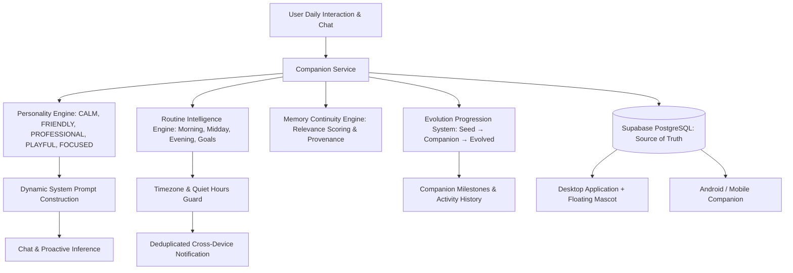

# TESS Phase 10: Living AI Companion
## Evolving Digital Pet, Adaptive Personality, Personal Routines & Long-Term Continuity

> **Core Product Vision:** *"TESS understands me, remembers my journey, adapts to my routines, helps me change my future and grows with my interactions."*

---

## 1. Overview & Architecture

Phase 10 is the capstone phase of the original TESS roadmap. It transforms TESS from a personal AI operating system into a continuously evolving, personalized AI companion that adapts to personal routines, develops an expressive identity, retains deep memory continuity, and synchronizes seamlessly across desktop and mobile.



---

## 2. Milestone Implementations

### Milestone 10.1 — Evolving Mascot & Personality
- **Implementation**: [`PersonalityEngine`](file:///home/bhavanamj/Desktop/Tess/backend/app/services/companion/personality.py), [`Mascot.tsx`](file:///home/bhavanamj/Desktop/Tess/desktop/src/components/Mascot.tsx), [`FloatingMascotWindow.tsx`](file:///home/bhavanamj/Desktop/Tess/desktop/src/mascot/FloatingMascotWindow.tsx)
- **Expressive States**:
  - `IDLE`, `HAPPY`, `CURIOUS`, `LISTENING`, `THINKING`, `SPEAKING`, `VIEWING`, `BROWSING`, `READING`, `PLANNING`, `CONFIRMING`, `ACTING`, `SUCCESS`, `RESTING`, `ERROR`, `ATTENTION`, `INTERVENING`, `SLEEPING`.
- **Visual Progression System**:
  - **Stage 1 (TESS Seed)**: Initial stage; standard expressions, core personality baseline.
  - **Stage 2 (TESS Companion)**: Unlocked at 10 interactions + 2 milestones; custom themes, expanded expression nuances, adaptive routine suggestions.
  - **Stage 3 (TESS Evolved)**: Unlocked at 30 interactions + 5 milestones; rich context-aware animations, full aura effects, multi-future synthesis.
  - Progression is based on meaningful interaction milestones, not idle time. Progression can also be toggled off by the user to unlock all visual features immediately.
- **Customization Options**:
  - Color Palettes: `PURPLE` (`#8B5CF6`), `CYAN` (`#06B6D4`), `AMBER` (`#F59E0B`), `EMERALD` (`#10B981`), `ROSE` (`#F43F5E`), `INDIGO` (`#6366F1`).
  - Expression Styles: `EXPRESSIVE`, `CLASSIC`, `MINIMAL`.
  - Animation Levels: `MINIMAL`, `NORMAL`, `LIVELY`.
  - Quiet Mode: Mutes alerts and transitions the mascot to a restful state.

### Milestone 10.2 — Adaptive Personal Routines
- **Implementation**: [`RoutineEngine`](file:///home/bhavanamj/Desktop/Tess/backend/app/services/companion/routine_engine.py), [`companion.py`](file:///home/bhavanamj/Desktop/Tess/backend/app/api/companion.py)
- **Supported Routine Types**:
  - `MORNING_BRIEFING`: Daily high-impact priority briefing and schedule check.
  - `DAILY_PLANNING`: Workday structure and priority task alignment.
  - `WORKDAY_CHECK_IN`: Midday momentum pulse check against active packages.
  - `EVENING_REVIEW`: Daily accomplishment wrap-up and reflection.
  - `WEEKLY_REVIEW`: Weekly velocity reflection and upcoming horizon overview.
  - `GOAL_CHECK_IN`: Alignment check connecting daily tasks to primary goals.
- **Timezone & Quiet Hours Safeguards**:
  - Validates time against the user's configured timezone.
  - Respects quiet hours (e.g. 22:00 to 08:00 overnight or midday quiet windows).
  - Enforces an 8-hour deduplication window so routines never spam the user.

### Milestone 10.3 — Intelligent Proactive Companion
- **Implementation**: Bridges [`InterventionService`](file:///home/bhavanamj/Desktop/Tess/backend/app/services/proactive/intervention_service.py), [`PersonalBehavioralModel`](file:///home/bhavanamj/Desktop/Tess/backend/app/services/future/behavioral_model.py), and [`CompanionService`](file:///home/bhavanamj/Desktop/Tess/backend/app/services/companion/service.py).
- Prioritizes usefulness over frequency; suppresses repeated alerts for dismissed items.
- All high-impact external actions continue through Phase 6 deterministic confirmation safeguards.

### Milestone 10.4 — Long-Term Memory & Continuity
- **Implementation**: [`MemoryContinuityEngine`](file:///home/bhavanamj/Desktop/Tess/backend/app/services/companion/memory_continuity.py), [`MemoryScreen.tsx`](file:///home/bhavanamj/Desktop/Tess/desktop/src/screens/MemoryScreen.tsx)
- **Relevance-Scored Retrieval**: Evaluates user queries against memory content and importance to select the top relevant items, preventing LLM prompt blowup.
- **Outdated Information Detection**: Identifies memories older than 60 days lacking recent confirmation.
- **Provenance & Fact Confirmation**: Distinguishes confirmed facts (`CONFIRMED`) from inferred observations (`INFERRED`), with provenance tracking (`USER_STATED`, `AGENT_OBSERVED`, `INFERRED`).
- **User Control & Correction**: Memory correction supported via `PUT /api/v1/memories/{memory_id}`.

### Milestone 10.5 — Personalized Companion Experience
- **Personality Presets**:
  - `CALM`: Tranquil, steady, reassuring, minimalist tone.
  - `FRIENDLY`: Warm, supportive, conversational, approachable.
  - `PROFESSIONAL`: Objective, analytical, structured, execution-focused.
  - `PLAYFUL`: Energetic, witty, curious, upbeat.
  - `FOCUSED`: Essentialist, high-signal, zero conversational filler.
- **Configurable Dimensions**:
  - Communication Style: `CONCISE`, `BALANCED`, `DETAILED`.
  - Encouragement Style: `GENTLE`, `ENERGETIC`, `PRAGMATIC`.
  - Formality Level: `CASUAL`, `NEUTRAL`, `FORMAL`.
- **Strict Ethical Boundaries**:
  - Explicit prompt guards prohibit claiming human sentience, emotional distress upon user absence, or guilt-inducing retention loops.

### Milestone 10.6 — Unified Cross-Device Experience
- **Cross-Device Synchronization**:
  - Supabase PostgreSQL remains the central source of truth.
  - Companion preferences, personality presets, routines, and mascot themes are synchronized across desktop and mobile.
  - Floating desktop mascot and mobile companion both reflect consistent companion stage, color palette, and quiet mode.

---

## 3. Database Schema Extensions

Tables added to [`backend/schema.sql`](file:///home/bhavanamj/Desktop/Tess/backend/schema.sql) with Row Level Security (RLS) enabled:

```sql
-- 1. Companion Preferences
CREATE TABLE IF NOT EXISTS companion_preferences (
    id UUID PRIMARY KEY DEFAULT uuid_generate_v4(),
    user_id UUID REFERENCES profiles(id) ON DELETE CASCADE UNIQUE,
    personality TEXT NOT NULL DEFAULT 'FRIENDLY',
    communication_style TEXT NOT NULL DEFAULT 'BALANCED',
    proactivity_level TEXT NOT NULL DEFAULT 'BALANCED',
    encouragement_style TEXT NOT NULL DEFAULT 'GENTLE',
    formality TEXT NOT NULL DEFAULT 'NEUTRAL',
    mascot_theme TEXT NOT NULL DEFAULT 'PURPLE',
    expression_style TEXT NOT NULL DEFAULT 'EXPRESSIVE',
    animation_level TEXT NOT NULL DEFAULT 'NORMAL',
    sound_enabled BOOLEAN DEFAULT FALSE,
    quiet_mode BOOLEAN DEFAULT FALSE,
    quiet_hours_start TEXT DEFAULT '22:00',
    quiet_hours_end TEXT DEFAULT '08:00',
    progression_enabled BOOLEAN DEFAULT TRUE,
    current_stage INT DEFAULT 1,
    interaction_count INT DEFAULT 0,
    created_at TIMESTAMPTZ DEFAULT NOW(),
    updated_at TIMESTAMPTZ DEFAULT NOW()
);

-- 2. Personal Routines
CREATE TABLE IF NOT EXISTS companion_routines (
    id UUID PRIMARY KEY DEFAULT uuid_generate_v4(),
    user_id UUID REFERENCES profiles(id) ON DELETE CASCADE,
    routine_name TEXT NOT NULL,
    routine_type TEXT NOT NULL,
    preferred_time TEXT NOT NULL,
    days_of_week JSONB NOT NULL DEFAULT '["MON","TUE","WED","THU","FRI"]'::jsonb,
    timezone TEXT NOT NULL DEFAULT 'UTC',
    enabled BOOLEAN DEFAULT TRUE,
    last_run_at TIMESTAMPTZ,
    created_at TIMESTAMPTZ DEFAULT NOW(),
    updated_at TIMESTAMPTZ DEFAULT NOW()
);

-- 3. Companion Evolution Milestones
CREATE TABLE IF NOT EXISTS companion_milestones (
    id UUID PRIMARY KEY DEFAULT uuid_generate_v4(),
    user_id UUID REFERENCES profiles(id) ON DELETE CASCADE,
    milestone_type TEXT NOT NULL,
    title TEXT NOT NULL,
    description TEXT NOT NULL,
    stage_unlocked INT DEFAULT 1,
    achieved_at TIMESTAMPTZ DEFAULT NOW()
);

-- 4. Companion Activity History
CREATE TABLE IF NOT EXISTS companion_activity (
    id UUID PRIMARY KEY DEFAULT uuid_generate_v4(),
    user_id UUID REFERENCES profiles(id) ON DELETE CASCADE,
    activity_type TEXT NOT NULL,
    summary TEXT NOT NULL,
    metadata JSONB DEFAULT '{}'::jsonb,
    created_at TIMESTAMPTZ DEFAULT NOW()
);

-- 5. Memory Provenance & Confirmation
ALTER TABLE memories ADD COLUMN IF NOT EXISTS is_confirmed BOOLEAN DEFAULT TRUE;
ALTER TABLE memories ADD COLUMN IF NOT EXISTS provenance TEXT DEFAULT 'USER_STATED';
```

---

## 4. API Endpoints

Registered under `/api/v1/companion`:

| Method | Endpoint | Description |
|---|---|---|
| `GET` | `/api/v1/companion/profile` | Retrieve full companion profile, stage, and active routine counts. |
| `GET` | `/api/v1/companion/preferences` | Retrieve companion personality, theme, and quiet mode preferences. |
| `PUT` | `/api/v1/companion/preferences` | Update personality traits, color palette, or progression settings. |
| `GET` | `/api/v1/companion/routines` | List all user personal routines. |
| `POST` | `/api/v1/companion/routines` | Schedule a new personal routine. |
| `PUT` | `/api/v1/companion/routines/{id}` | Update an existing routine (time, days, enabled). |
| `DELETE` | `/api/v1/companion/routines/{id}` | Remove a routine. |
| `POST` | `/api/v1/companion/routines/check` | Evaluate and trigger due routines. |
| `GET` | `/api/v1/companion/milestones` | Retrieve companion milestones. |
| `GET` | `/api/v1/companion/activity` | Retrieve companion activity history log. |
| `PUT` | `/api/v1/memories/{memory_id}` | Edit or correct a memory item (content, importance, confirmed status). |

---

## 5. Verification & Test Summary

- **Backend Pytest**: `58/58 passed` in 3.00s (`tests/test_agent.py`, `tests/test_api.py`, `tests/test_future.py`, `tests/test_phase8.py`, `tests/test_phase9.py`, `tests/test_phase10.py`, `tests/test_proactive.py`).
- **Desktop Vitest**: `24/24 passed` in 1.51s (`desktop/src/test/desktop.test.tsx`).
- **Desktop Production Build**: TypeScript compilation + Vite production bundle passed (`built in 1.34s`).
- **Mobile Expo Export**: Clean bundle export for Android and iOS in 8.0s (`dist/` created, zero errors).

