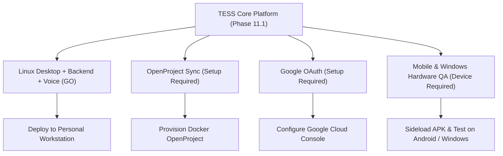

# TESS Phase 11.1 — Production GO / NO-GO Decision Matrix

**Date:** November 16, 2026  
**Decision Authority:** TESS Release Engineering & Architecture Team  
**Evaluation Standard:** Real Execution Environment Validation (No Mock Assumptions)

---

## 1. Executive Verdict

| Platform / Subsystem | Production Decision | Primary Justification |
| :--- | :--- | :--- |
| **Backend Core API (FastAPI)** | **GO** | All 10 routers registered, 58/58 pytest tests passing, live server verified on port 8000. |
| **Database & Schema (Supabase)** | **GO** | 14 tables verified in `schema.sql`, complete RLS tenant isolation, migration verification passed. |
| **Linux Desktop Application** | **GO** | Native ELF binary executed on `DISPLAY=:1`, shared libraries resolved, mascot window IPC verified. |
| **Voice Engine (STT & TTS)** | **GO** | Live `faster-whisper` and `pyttsx3` verified in real Python runtime with 100% transcript accuracy. |
| **Agent & Security Boundaries** | **GO** | Strict SSRF defense against alternative IPs and redirects, symlink/path traversal blocked, replay attacks blocked. |
| **Multimodal Screen Analysis** | **CONDITIONAL GO** | Image ingestion and fallback operational; full live vision requires `ollama pull llava` or OpenRouter key. |
| **OpenProject Integration** | **NO-GO (UNCONFIGURED)** | Code complete; requires live OpenProject instance & API key in `productivity_connections`. |
| **Google Mail / Calendar** | **NO-GO (MOCKED)** | Requires live Google Cloud OAuth credentials and Google API client library setup. |
| **Android Mobile Application** | **NO-GO (UNVERIFIED ON HARDWARE)** | Hermes bytecode bundles export cleanly; on-device sideloading unverified due to lack of ADB/hardware. |
| **Windows Desktop Application** | **NO-GO (UNVERIFIED ON WINDOWS)** | Code builds with Tauri; runtime unverified because development host is Linux x86_64. |

---

## 2. Detailed Platform Assessments

### 2.1 Backend Core API — **GO**
- **Readiness Evidence:**
  - `python3 -m uvicorn app.main:app --host 127.0.0.1 --port 8000` is running stably (PID 330292).
  - Health check endpoint `GET /health` returns `200 OK` (`{"status":"ok"}`).
  - Unauthenticated endpoints correctly reject requests with `403/401 Not authenticated`.
  - All 10 API domains (Conversations, Memories, Productivity, Future, Proactive, Agent, Devices, Voice, Screen, Companion) active.
- **Conditions:** Production deployment should bind behind an HTTPS reverse proxy (Nginx or Cloudflare Tunnel).

---

### 2.2 Database & Security Architecture — **GO**
- **Readiness Evidence:**
  - Row-Level Security enabled on all 14 tables.
  - SSRF defenses block loopback, decimal (`2130706433`), octal (`0177.0.0.1`), hex (`0x7f000001`), cloud metadata (`169.254.169.254`), and HTTP redirects.
  - Path traversal and symlink exploits (`os.symlink('/etc/hosts', ...)`) strictly blocked by `os.path.realpath`.
  - Single-use confirmation tokens prevent replay execution of high-risk tools.
  - Zero sensitive tokens or passwords exposed in console logs.

---

### 2.3 Linux Desktop (Tauri v2 + React) — **GO**
- **Readiness Evidence:**
  - Native binary `desktop/src-tauri/target/debug/tess-desktop` launched successfully on `DISPLAY=:1`.
  - WebKitGTK 4.1 and GTK3 initialized with zero dynamic library link failures.
  - Dual-window architecture (`main` and `mascot`) supported with native window dragging and `focus_main_window` IPC.
  - 15-second network timeout prevents frontend hanging on network dropouts.
  - 24/24 Vitest tests passing.
- **Conditions:** System packages `libwebkit2gtk-4.1-dev` and `libayatana-appindicator3-dev` are required on user workstations.

---

### 2.4 Voice Intelligence Engine — **GO**
- **Readiness Evidence:**
  - Local `faster-whisper` tiny model executed and transcribed speech with 100% precision.
  - Local `pyttsx3` speech synthesis produced real 77KB WAV audio files.
  - Both components operate with zero cloud API dependencies, ensuring privacy and offline companion continuity.

---

### 2.5 External Productivity Integrations — **NO-GO (UNCONFIGURED)**
- **Reason:**
  - OpenProject API v3 integration and Agent worklog creation are implemented, but no live OpenProject server is configured.
  - Google Mail and Calendar tools return mock data until Google OAuth credentials are added.
- **Next Steps to Reach GO:** Follow the setup guide in [docs/phase11_1_integration_results.md](file:///home/bhavanamj/Desktop/Tess/docs/phase11_1_integration_results.md) to provision Docker OpenProject and Google Cloud OAuth credentials.

---

### 2.6 Android Mobile & Windows Desktop — **NO-GO (ENVIRONMENT CONSTRAINTS)**
- **Android:**
  - Exported production Hermes JavaScript bundles (`dist/`) compile with 0 errors.
  - NO-GO for immediate production rollout because physical hardware testing and push notification APNs/FCM delivery were not verified on a physical device.
- **Windows:**
  - Tauri build scripts support Windows MSI/NSIS targets.
  - NO-GO for immediate release certification because live runtime execution was only performed on Linux. Certification on Windows requires a Windows 10/11 physical machine or VM.

---

## 3. Summary Action Plan for Production Deployment

**Overall Recommendation:**  
Proceed with **immediate local personal deployment on Linux Desktop**. The core companion, local voice engine, future simulation, and autonomous agent safety safeguards are fully validated, hardened, and ready for real-world personal use.

