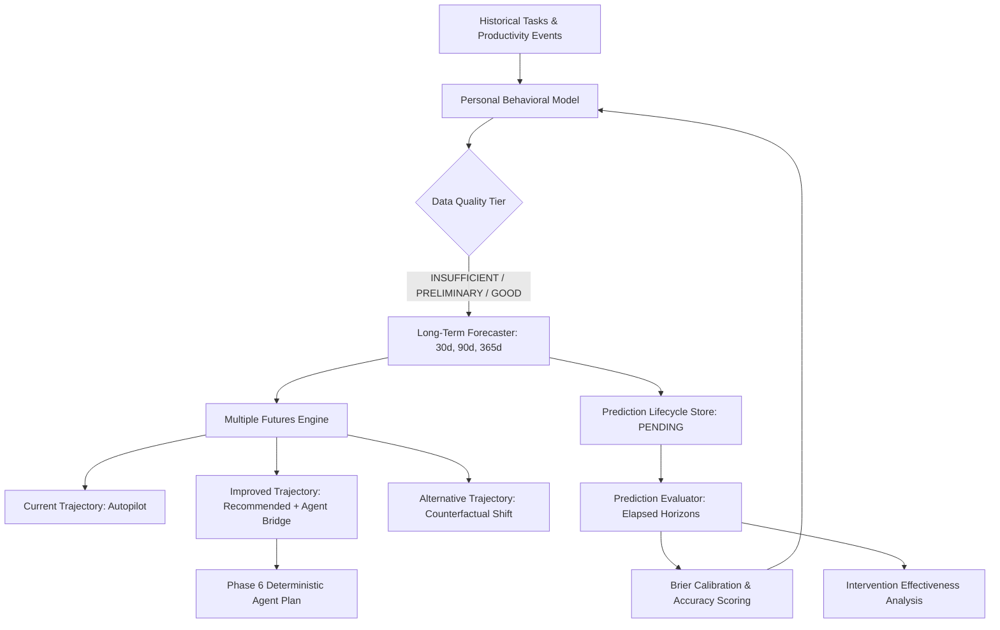

# TESS Phase 9: Advanced Future Intelligence
## Personal Behavioral Intelligence, Long-Term Forecasting & Multiple Future Selves

> **Core Product Thesis:** *"Show me the most likely version of myself that I am currently creating."*

---

## 1. Overview & Architecture

Phase 9 evolves TESS from short-term pattern predictions and simulations into a closed-loop personal future intelligence engine. Rather than relying on static or speculative LLM projections, TESS extracts deterministic behavioral metrics from historical event streams, bounds long-term projections using asymptotic velocity models, contrasts multiple future trajectories, evaluates prediction accuracy via Brier scores once horizons elapse, and continuously refines its personal model.



---

## 2. Milestone Implementations

### Milestone 9.1 — Personal Behavioral Intelligence
- **Component**: `backend/app/services/future/behavioral_model.py` (`PersonalBehavioralModel`)
- **Key Dimensions**:
  - `completion_rate`: Ratio of completed vs total tasks across 7d–90d windows.
  - `overdue_rate` & `overdue_escalation`: Frequency of missed deadlines and aging patterns.
  - `inflow_rate_per_day` vs `completion_velocity_per_day`: Work accumulation momentum.
  - `intervention_responsiveness`: Historical acceptance and dismissal of proactive interventions.
- **Cold-Start Handling & Quality Tiers**:
  - `INSUFFICIENT` ($N < 3$ items): Cold-start mode; conservative baselines applied with explicit user disclosure.
  - `PRELIMINARY` ($3 \le N < 10$ items): Initial empirical patterns emerging.
  - `GOOD` ($N \ge 10$ items): High-confidence personal behavioral baseline.

### Milestone 9.2 — Long-Term Future Forecasting
- **Component**: `backend/app/services/future/forecaster.py` (`LongTermForecaster`)
- **Horizons**: `30d`, `90d`, `365d`
- **Asymptotic Backlog Modeling**:
  - Prevents runaway linear accumulation over 90 or 365 days.
  - Accounts for natural inflow throttling, task prioritization decay, and completion saturation:
    $$\Delta B(t) = \text{inflow} \cdot (1 - \text{decay})^t - \text{velocity} \cdot \left(1 - \frac{B(t)}{K}\right)$$
  - Returns `projected_backlog`, `completion_forecast`, `burnout_risk_score`, `uncertainty_range`, explicit assumptions, and explainable evidence.

### Milestone 9.3 — Multiple Future Selves
- **Component**: `backend/app/services/future/multiple_futures.py` (`MultipleFuturesEngine`)
- **Trajectories**:
  1. **Current Trajectory (`CURRENT`)**: Continuation of current velocity, overdue habits, and backlog growth (Autopilot).
  2. **Improved Trajectory (`IMPROVED`)**: Optimal trajectory achievable through structured behavioral adjustments, focused work blocks, and backlog pruning.
  3. **Alternative Trajectory (`ALTERNATIVE`)**: Counterfactual projection under modified constraints, scope reduction, or changed deadlines.
- **Direct Action Bridge**:
  - The desktop UI provides a 1-click **"Act on This Path with Agent"** button. This automatically generates a Phase 6 Agent Objective (`apiService.createAgentObjective`), converting future foresight directly into executable actions with confirmation safeguards.

### Milestone 9.4 — Prediction Accuracy & Empirical Learning
- **Component**: `backend/app/services/future/evaluation.py` (`PredictionEvaluator`)
- **Lifecycle States**: `PENDING` $\rightarrow$ `EVALUATED` $\rightarrow$ `CONFIRMED` | `PARTIALLY_CONFIRMED` | `NOT_CONFIRMED` | `INSUFFICIENT_DATA`.
- **Temporal Integrity**:
  - Predictions are strictly evaluated only **after** their time horizon has elapsed ($t_{\text{now}} \ge t_{\text{created}} + \Delta t_{\text{horizon}}$).
- **Brier Calibration Score**:
  $$\text{Brier} = \frac{1}{N} \sum_{i=1}^N (p_i - o_i)^2$$
  - Measures probabilistic calibration (where $0.00$ represents perfect calibration).
  - Breakdown metrics computed by time horizon (`24h`, `3d`, `7d`, `30d`) and prediction type (`RISK`, `DEADLINE`, `MOMENTUM`).

### Milestone 9.5 — Intervention Effectiveness Analysis
- **Component**: `backend/app/services/future/intervention_effectiveness.py` (`InterventionEffectivenessService`)
- **Metrics Tracked**:
  - Acceptance Rate ($\text{accepted} / \text{total}$)
  - Action Conversion Rate ($\text{actions completed} / \text{total}$)
  - Behavioral response insights identifying optimal intervention timing and user receptivity.

### Milestone 9.6 — Desktop UI & Future Intelligence Dashboard
- **Component**: `desktop/src/screens/FuturesScreen.tsx`
- **Tabs**:
  1. **Short-Term (`overview`)**: 24h, 3d, 7d simulation and active pattern predictions.
  2. **Long-Term Forecast (`longterm`)**: 30d, 90d, 365d asymptotic projections, uncertainty ranges, burnout scores, assumptions, and evidence.
  3. **Multiple Selves (`multiple_futures`)**: Side-by-side comparison of Current, Improved, and Alternative trajectories, with the 1-click Phase 6 Agent bridge.
  4. **Behavioral Intel (`behavioral`)**: Multi-window analysis (7d–90d), data quality tier indicators, completion/overdue rates, and inflow momentum.
  5. **Accuracy & Learning (`accuracy`)**: Brier calibration, overall accuracy, horizon breakdown, recent evaluation logs, and manual evaluation trigger.

---

## 3. Database Schema Extensions

Tables added to `backend/schema.sql` with Row Level Security (RLS) enabled:

```sql
-- 1. Behavioral Snapshots
CREATE TABLE IF NOT EXISTS behavioral_snapshots (
  id UUID PRIMARY KEY DEFAULT gen_random_uuid(),
  user_id UUID REFERENCES auth.users(id) ON DELETE CASCADE,
  window_days INT NOT NULL DEFAULT 30,
  data_quality VARCHAR(32) NOT NULL,
  metrics JSONB NOT NULL DEFAULT '{}'::jsonb,
  insights JSONB NOT NULL DEFAULT '[]'::jsonb,
  created_at TIMESTAMPTZ DEFAULT NOW()
);

-- 2. Prediction Evaluations & Calibration Scores
CREATE TABLE IF NOT EXISTS prediction_evaluations (
  id UUID PRIMARY KEY DEFAULT gen_random_uuid(),
  prediction_id UUID REFERENCES future_predictions(id) ON DELETE CASCADE,
  user_id UUID REFERENCES auth.users(id) ON DELETE CASCADE,
  horizon VARCHAR(32) NOT NULL,
  predicted_outcome TEXT NOT NULL,
  actual_outcome TEXT NOT NULL,
  status VARCHAR(32) NOT NULL,
  brier_score FLOAT,
  evaluated_at TIMESTAMPTZ DEFAULT NOW()
);

-- 3. Forecast Model Versions
CREATE TABLE IF NOT EXISTS forecast_model_versions (
  id UUID PRIMARY KEY DEFAULT gen_random_uuid(),
  user_id UUID REFERENCES auth.users(id) ON DELETE CASCADE,
  version_tag VARCHAR(32) NOT NULL,
  calibration_score FLOAT,
  parameters JSONB NOT NULL DEFAULT '{}'::jsonb,
  created_at TIMESTAMPTZ DEFAULT NOW()
);

-- 4. Intervention Evaluations
CREATE TABLE IF NOT EXISTS intervention_evaluations (
  id UUID PRIMARY KEY DEFAULT gen_random_uuid(),
  intervention_id UUID REFERENCES proactive_interventions(id) ON DELETE CASCADE,
  user_id UUID REFERENCES auth.users(id) ON DELETE CASCADE,
  accepted BOOLEAN NOT NULL DEFAULT FALSE,
  action_completed BOOLEAN NOT NULL DEFAULT FALSE,
  evaluation_notes TEXT,
  created_at TIMESTAMPTZ DEFAULT NOW()
);
```

---

## 4. API Endpoints

All endpoints registered under `/api/v1/future`:

| Method | Endpoint | Description |
|---|---|---|
| `GET` | `/api/v1/future/behavior` | Retrieve behavioral metrics, quality tier, and evidence-backed insights. |
| `POST` | `/api/v1/future/forecast` | Generate 30d, 90d, or 365d asymptotic projections with uncertainty bounds. |
| `GET` | `/api/v1/future/forecast` | Retrieve forecast and prediction history. |
| `POST` | `/api/v1/future/scenarios` | Generate Multiple Future Selves (`CURRENT`, `IMPROVED`, `ALTERNATIVE`). |
| `POST` | `/api/v1/future/evaluate` | Evaluate elapsed predictions against observed task outcomes. |
| `GET` | `/api/v1/future/accuracy` | Retrieve Brier calibration score, overall accuracy, and horizon breakdowns. |
| `GET` | `/api/v1/future/intervention-effectiveness` | Retrieve acceptance rate, conversion rate, and behavioral feedback insights. |

---

## 5. Verification & Test Summary

- **Backend Pytest**: `49/49 passed` in 2.79s (`tests/test_agent.py`, `tests/test_api.py`, `tests/test_future.py`, `tests/test_phase8.py`, `tests/test_phase9.py`, `tests/test_proactive.py`).
- **Desktop Vitest**: `22/22 passed` in 1.38s (`desktop/src/test/desktop.test.tsx`).
- **Desktop Build**: TypeScript compilation + Vite production bundle passed (`built in 1.52s`).
- **Mobile Expo Export**: Clean bundle export for both Android and iOS in 8.4s (`dist/` created, zero errors).

